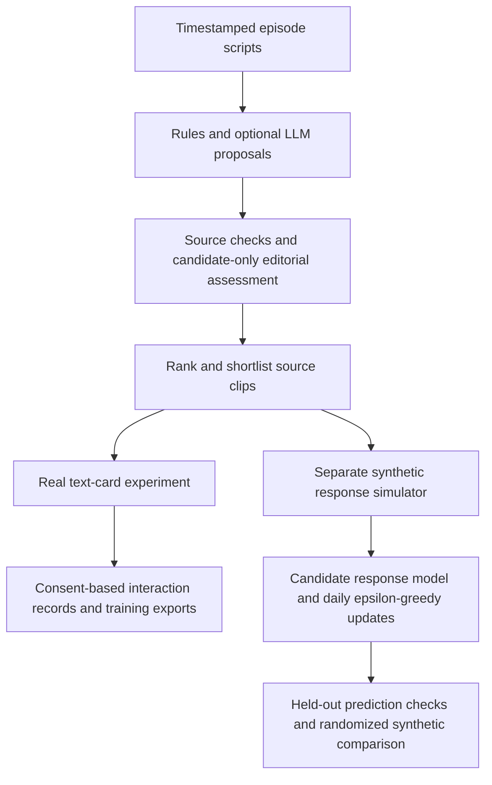

# Promo Lab

Find promising microdrama advertisements in timestamped scripts, inspect the source evidence, and collect feedback for a later audience model.

Built for **Kuku Problem 1: Find the Promos**. The application recommends 20–60-second source intervals; it does not render video. It runs locally with Python and includes an original fictional screenplay, so a reviewer can try it without credentials or the confidential input pack.

## Quick start

Requires **Python 3.10 or newer**. No API key, npm build, or database service is needed for the offline demo.

```bash
python3 -m promo_lab run promo_lab/examples --output output/runs/original-demo
python3 -m promo_lab serve
```

Open **http://127.0.0.1:8765**. The first command creates a demo analysis; the second starts the local interface. On Windows, use `py` instead of `python3` if needed. The server listens only on this computer; its URL is not a remotely hosted submission link.

| View | What you can do |
| --- | --- |
| Discover promos | Inspect ranked clips, episode timestamps, hook, ending, rationale and original source events |
| Episode library | Check which episodes were processed and inspect timing concerns |
| Quality report | Compare structural checks with a simple baseline and inspect actual rejected cuts |
| Run history | Reopen saved analyses and download JSON/CSV or a private run bundle |
| Reading experiment | Randomly show text promos among ordinary stories and record real reading behavior |
| Synthetic demo | Generate explicitly synthetic feedback, fit a small response model and compare selection policies |

To use a new input, choose **New analysis → Upload your screenplay files**, or run:

```bash
python3 -m promo_lab run path/to/scripts.zip --output output/runs/my-run
```

See the [input format](docs/INPUT_FORMAT.md) for a minimal example and accepted timestamps.

## What is implemented



The project has three distinct kinds of evidence:

- **Editorial analysis:** code checks boundaries, duration and source references. AI judgments of hook and cliffhanger remain estimates.
- **Real reading feedback:** actual participants supply foreground reading time, text coverage, skips and continuation choices. These are reading proxies, not video watch or conversion labels. Real-audience model training is deferred until sufficient data exists.
- **Synthetic learning demonstration:** a small Beta-Bernoulli model learns a success probability per candidate from generated responses. It demonstrates daily feedback updates and selection that gradually reaches 80% exploitation / 20% exploration. It does not train a text encoder or prove engagement improvement.

[Current architecture](docs/ARCHITECTURE.md) explains these boundaries. [ML_ARCHITECTURE.md](ML_ARCHITECTURE.md) specifies the later embedding-based audience model and production evaluation design.

## Optional LLM analysis

Copy `.env.example` to `.env`, configure a compatible endpoint, model and key, then restart the server. The generic adapter supports OpenRouter/Nemotron and other compatible services; Groq and local Ollama have separate configuration options.

```dotenv
PROMO_API_BASE=https://openrouter.ai/api/v1
PROMO_MODEL=nvidia/nemotron-3-ultra-550b-a55b:free
PROMO_API_KEY=your-key-here
```

```bash
python3 -m promo_lab run promo_lab/examples --provider openai \
  --output output/runs/my-ai-demo
```

`openai` names the compatible protocol; it does not require the OpenAI service. Model availability and provider quotas may change. The app never silently switches to a paid model. Python installations needing CA certificates can install the optional `ai` extra with `python3 -m pip install -e '.[ai]'`.

The configured free NVIDIA endpoint defaults to public inputs. Confidential processing requires an explicit owner authorization setting; this never marks the source public. See [provider configuration, caching and failure behavior](docs/PROVIDERS.md). Provider tests use mocked requests and do not establish live availability.

## Collect real feedback

Open **Reading experiment**, create a study and choose either the public demo or a saved shortlist. Each consenting participant receives six filler stories and one random target promo. All cards offer the same continuation action. Saved-run continuations use subsequent script text; no sequel is invented.

The report shows observed denominators, unknown outcomes, confidence intervals and separate repeat-exposure counts. Download `training.jsonl`, `training.csv`, `events.jsonl` or `report.json`. Unseen advertisements are not negative examples; interrupted outcomes stay unknown unless a positive was already observed. Software-test studies are excluded from default training exports.

Detailed event, label and deletion behavior: [reading experiment](docs/EXPERIMENT.md).

## Demonstrate the learning loop

Open **Synthetic demo**, choose a candidate source and generate a reproducible run. The default creates **4,800 synthetic exposures**: 400 cold-start, 200 held-out validation and 14 days with 150 viewers per policy arm per day.

Try three scenarios: fixed unequal appeal, equal appeal (no signal), and changing trends. The model receives synthetic feedback, while the simulator's assumed probabilities stay out of its inputs. Control and validation responses never update the policy model. No seed search or guaranteed improvement is used.

```bash
python3 scripts/run_synthetic_demo.py --scenario stationary --seed 42
python3 scripts/run_synthetic_demo.py --scenario no_signal --seed 42
```

Every generated row is labeled synthetic and ineligible for real-model training. [Synthetic demo assumptions and metrics](docs/SYNTHETIC_DEMO.md) explains how to present the results honestly.

## Verification

Core tests need only Python:

```bash
python3 -m unittest discover -s tests -v
python3 scripts/check_repository.py
python3 scripts/audit_run.py output/runs/original-demo
python3 scripts/run_http_checks.py
```

Optional development tools provide consistent formatting and browser checks:

```bash
python3 -m pip install -e '.[dev]'
npm ci
npx playwright install chromium
make check
npm run format:check
PLAYWRIGHT_CHANNEL=chromium python3 scripts/run_http_checks.py --browser
```

The HTTP/browser wrapper starts a server on a free port with a temporary database and shuts it down afterward. Browser runs check desktop/mobile layout, uploads, real-interaction logging, offline retries, deletion, synthetic provenance and exports. Test responses do not enter your live experiment data. See [development and GitHub Actions](CONTRIBUTING.md) and the [verification record](docs/VALIDATION.md).

## Repository map

```text
promo_lab/       Parser, editorial pipeline, API adapters, experiment and simulator
  web/           Vanilla HTML, CSS and JavaScript interface
  examples/      Original public screenplay
scripts/         Audits, isolated checks, synthetic demo and submission packaging
tests/           Source integrity, provider, experiment and simulation tests
docs/            Architecture, setup, measurement contracts and submission guide
.github/         Automated checks; no deployment or API credentials required
```

Generated state is local and Git-ignored:

| Path | Contents |
| --- | --- |
| `output/runs/` | Editorial results, source text, raw model responses and audit manifests |
| `output/provider_cache/` | Private cached provider requests/responses |
| `output/experiments/` | Real interaction SQLite database |
| `output/simulations/` | Clearly labeled synthetic responses, reports and model snapshots |
| `output/pdf/` | Generated solution document |

## Submission and limits

Use the [submission guide](docs/SUBMISSION.md) to build the two-page solution PDF, audit the full-pack outputs and create separate source/private archives. The [walkthrough outline](docs/WALKTHROUGH.md) is for an optional recording in the applicant's own voice. Review the work and submit only what you understand.

The saved private full-pack run covers 50 episodes and selects six promos. Its editorial model was Groq Qwen; the saved Nemotron run verifies integration on original public fiction. These outputs are local artifacts, not part of a fresh checkout. See [editorial scoring, deduplication and failure modes](docs/EDITORIAL_PIPELINE.md).

Human review remains necessary for standalone comprehension, acting, precise footage timing and visual joins. The prototype has no remote hosting, production model promotion or validated real-audience predictor. Contrastive learning and encoder fine-tuning remain future improvements.

Confidential Kuku scripts, participant records, raw outputs and API keys must stay out of a public repository. Source packaging uses an allowlist and credential checks. Codex assisted implementation, tests and documentation; inference providers are disclosed in each run. Detailed [solution narrative](docs/SOLUTION.md).
