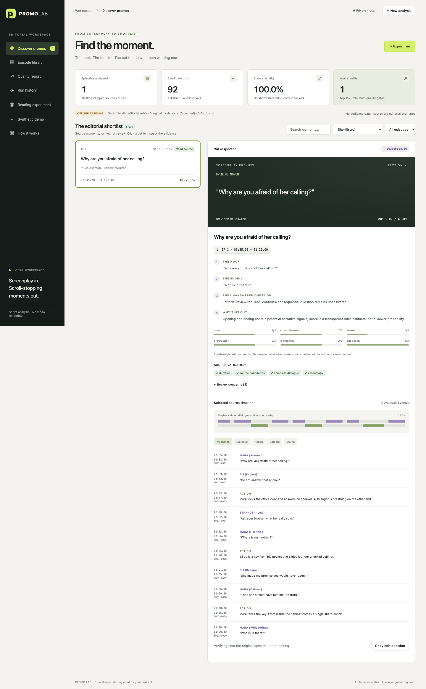
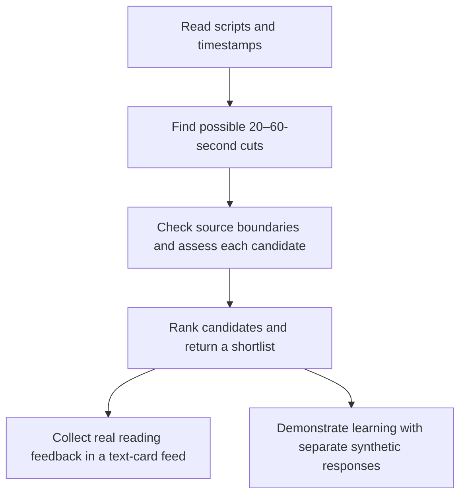

# Promo Lab

[](https://github.com/akshitmanocha/kuku-assignment-submission/actions/workflows/checks.yml)

Promo Lab reads a timestamped screenplay and finds short sections that could work as advertisements. For each recommendation, it shows the episode, exact start and end points, opening hook, unresolved ending, and the reason for choosing it.

This is my submission for **Kuku's “Find the Promos” problem**. The goal is to give an editor a useful shortlist and enough evidence to judge each cut. The project also includes a small reading experiment and a separate simulation of learning from audience feedback.

<details>
<summary>See the workbench</summary>



The screenshot uses the included fictional example and the offline scorer.

</details>

## Try it locally

You need **Python 3.10+**. The basic demo needs no API key or additional packages.

```bash
git clone https://github.com/akshitmanocha/kuku-assignment-submission.git
cd kuku-assignment-submission
python3 -m promo_lab run promo_lab/examples --output output/runs/original-demo
python3 -m promo_lab serve
```

Open **http://127.0.0.1:8765**. The first command analyses the included example; the second starts the app. On Windows, use `py` instead of `python3` if needed.

To analyse your own scripts, choose **New analysis → Upload your screenplay files**, or use the CLI:

```bash
python3 -m promo_lab run path/to/scripts.zip --output output/runs/my-run
```

TXT files, folders and ZIP archives are supported. The [input guide](docs/INPUT_FORMAT.md) explains the format. The app runs on your computer; it is not a hosted website.

## How it works



**Finding the promos.** The parser keeps dialogue, actions and timestamps tied to their source. Rules generate possible cuts, and an optional LLM proposes and assesses candidates. Code checks duration, source references, chronological order and whether a boundary cuts through dialogue. Candidates are ranked on hook, clarity, stakes, progression, cliffhanger and cut quality. Similar overlapping cuts are grouped before selecting the requested top 1%, subject to quality checks.

**Collecting feedback.** In **Reading experiment**, a participant sees six ordinary story cards and one randomly chosen promo. With consent, the app records reading time, visible text, skips and “Keep reading” clicks. Repeated views remain separate records; missing responses are not treated as failures. This collects reading behavior, not video engagement. See the [experiment guide](docs/EXPERIMENT.md).

**Showing the learning loop.** In **Synthetic demo**, generated responses train a small model that estimates a success probability for each promo. It starts with random choices, then gradually moves to 80% choosing the estimated best candidate and 20% exploring. The model updates daily and is compared with a random control. Try fixed preferences, equal preferences and changing trends. These are explicitly synthetic results, kept separate from real responses. See the [simulation guide](docs/SYNTHETIC_DEMO.md).

The current learning model uses candidate identity and success/failure counts. A text embedding model trained on substantial real feedback is a later step. The [current architecture](docs/ARCHITECTURE.md) and [future ML design](ML_ARCHITECTURE.md) explain the distinction.

## Use an LLM

The app supports an OpenAI-compatible endpoint, a separate Groq configuration, or local Ollama. Copy `.env.example` to `.env`, add your model settings and key, then restart the app. For example:

```dotenv
PROMO_API_BASE=https://openrouter.ai/api/v1
PROMO_MODEL=nvidia/nemotron-3-ultra-550b-a55b:free
PROMO_API_KEY=your-key-here
```

```bash
python3 -m promo_lab run promo_lab/examples --provider openai \
  --output output/runs/my-ai-demo
```

Here, `openai` refers to the API format, not necessarily the OpenAI service. The model can be swapped without changing the pipeline. The offline demo remains available if a provider is unavailable. See [provider setup](docs/PROVIDERS.md) for input restrictions, caching, partial runs and the other options.

## Results and limitations

The saved full-pack run processed **50 episodes and 3,727 timestamped events**, generated **16,023 candidate cuts**, and returned **six shortlisted promos**. It used Groq Qwen; a separate Nemotron run checked integration on the included public example. The private screenplay pack and raw outputs are not in this repository.

The quality report compares source validity and dialogue truncation with a simple fixed-window baseline. Those checks show that edit boundaries are being enforced; they do not establish that viewers will prefer the shortlist. LLM scores are editorial estimates, and the synthetic learning curves depend on the simulator's assumptions.

Acting, visual continuity and precise footage timing still need an editor's review. Production hosting, real-audience model training and encoder fine-tuning are future work.

## Run the checks

The core tests use only Python:

```bash
python3 -m unittest discover -s tests -v
python3 scripts/check_repository.py
python3 scripts/run_http_checks.py
```

For formatting and browser checks:

```bash
python3 -m pip install -e '.[dev]'
npm ci
npx playwright install chromium
make check
npm run format:check
PLAYWRIGHT_CHANNEL=chromium python3 scripts/run_http_checks.py --browser
```

The browser checks use a temporary server and database, so they do not change saved participant data. GitHub Actions runs the checks on pushes and pull requests. Details are in [CONTRIBUTING.md](CONTRIBUTING.md) and the [verification record](docs/VALIDATION.md).

## Code and documentation

- `promo_lab/` — parser, candidate selection, provider adapters, experiments and simulation.
- `promo_lab/web/` — the HTML, CSS and JavaScript interface; no frontend build step.
- `promo_lab/examples/` — original public fiction for trying the project.
- `tests/` — parsing, model-output validation, event logging and simulation tests.
- `scripts/` — audits, browser checks, document generation and packaging.

The app saves analyses, model caches, real interactions and synthetic runs separately under `output/`. That directory and `.env` are ignored by Git. Supplied Kuku scripts, participant responses and API keys are not included in the public source.

For the assignment materials, see the [solution notes](docs/SOLUTION.md), [submission guide](docs/SUBMISSION.md) and [short walkthrough outline](docs/WALKTHROUGH.md).

Codex assisted with implementation, tests and documentation. Each saved analysis records which inference model was used, along with its original responses and any rejected proposals.
