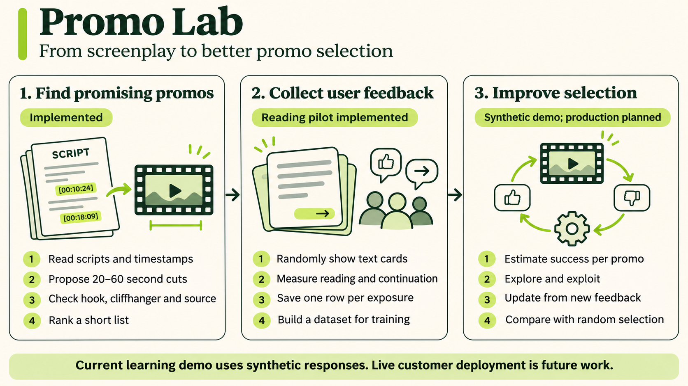
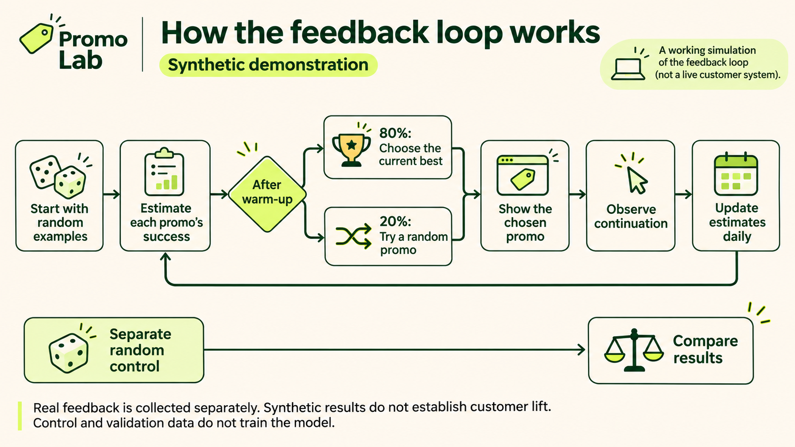
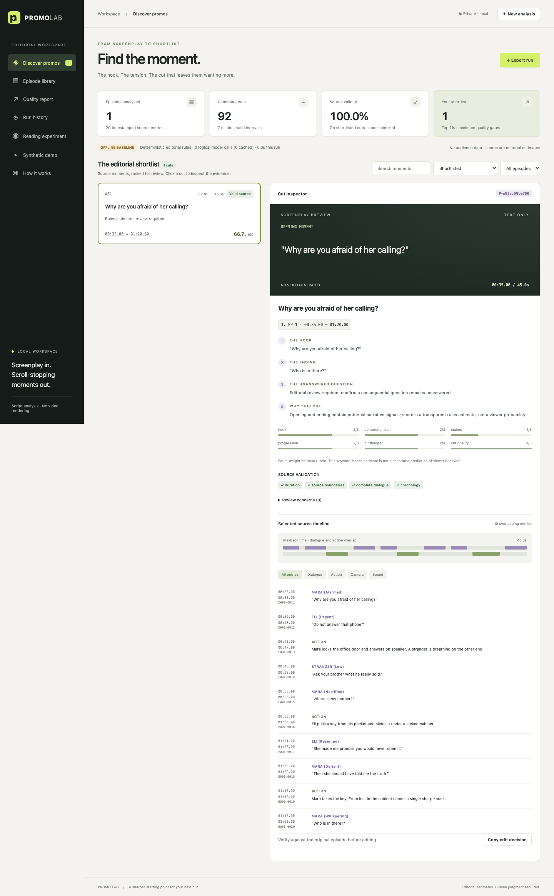

# Current architecture

There are three product stages. The first is implemented, the second collects real reading feedback, and the third is demonstrated with synthetic feedback. Production deployment and a real-audience model are later work.

## 1. Editorial discovery

`domain.py` parses TXT/ZIP inputs into episodes and overlapping dialogue, action, camera and sound events. Timestamps are integer milliseconds. `pipeline.py` enumerates plausible boundaries and accepts source-referenced LLM proposals through `providers.py`.

Code checks duration, referenced IDs, source bounds, chronology, overlaps and dialogue truncation. The optional second LLM prompt sees candidate-only dialogue/actions and scores hook, comprehension, stakes, progression, cliffhanger and cut quality. These scores estimate editorial promise, not customer success. One candidate per episode is critiqued to bound API usage. Invalid or unassessed AI candidates do not qualify.

Temporal deduplication groups interval variants; selection targets up to `ceil(distinct_valid_intervals × shortlist_percent / 100)`, subject to minimum gates. The default percentage is 1. This denominator and gate behavior are prototype assumptions. A human reviews the resulting edit decisions.

## 2. Real feedback collection

`experiment_content.py` freezes source-valid text cards and genuine following script text, or original public fiction. `experiments.py` persists consented sessions and validated events in SQLite. Each browser participant receives one random target among six filler stories. Original experiment assignments, content and label definitions are frozen.

An exposure row separates pre-exposure X from observed Y. Repeated exposures are separate rows. Unseen promos have no outcome row. Interrupted negative outcomes are unknown, and partial duration/coverage is marked partial. The report uses first exposures for primary rates and discloses denominator-specific missingness and uncertainty.

The main reading target is an actual continuation click followed by at least 15 active continuation seconds and 75% continuation-unit visibility. This is different from a future video/show-conversion target. See [event and label contract](EXPERIMENT.md).

## 3. Synthetic learning demonstration

`simulations.py` reads the study's candidate snapshot without copying or modifying participant responses. It assumes candidate appeal and generates consistent synthetic X/Y rows in a separate directory. Every export is marked synthetic and excluded from real training by provenance flags.

The current model is candidate-level Beta-Bernoulli: start with Beta(1,1), add success/failure counts and predict their posterior mean. Historical excess counts decay by 0.9 daily. Candidate identity is its only predictor; it does not consume text embeddings or the recorded context fields. Validation and random-control feedback never fit the model.

Uniform cold-start traffic supplies the initial data. Online simulated exploration decreases from 60% to 20% by day 5; exploitation uses the highest current estimate. The policy freezes during each simulated day and updates at day end. Each selection logs its actual marginal probability. Prediction checks use Brier score/log loss; policy reports compare synthetic qualified-reading rates with random control. See [simulation mechanism and assumptions](SYNTHETIC_DEMO.md).

## Application and storage

The frontend is vanilla HTML/CSS/JavaScript; `server.py` provides a local HTTP API and a single background analysis worker. The Python launch binds to loopback by default. The Docker launch binds inside the container and publishes the port on host loopback. Model keys are server-side. Real events, synthetic rows and editorial outputs are separate stores. The server has local host/origin checks and a restricted static-file allowlist. It is not an authenticated multi-user hosting service.

## Future production loop

After enough mature real outcomes exist: fit an audience model, evaluate on later held-out participants/content, introduce a controlled customer pilot, collect new feedback, retrain in batches and promote only versions passing evaluation and monitored rollout. A text encoder plus content/context features could generalize to unseen promos. Model registry, secure hosting, rollback, data access and scheduling are not currently implemented. Contrastive learning and encoder adaptation are explicitly future experiments. See the [reference ML specification](../ML_ARCHITECTURE.md).

## Workbench preview

